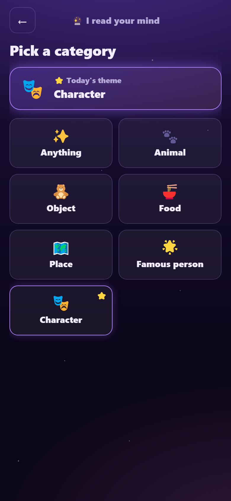
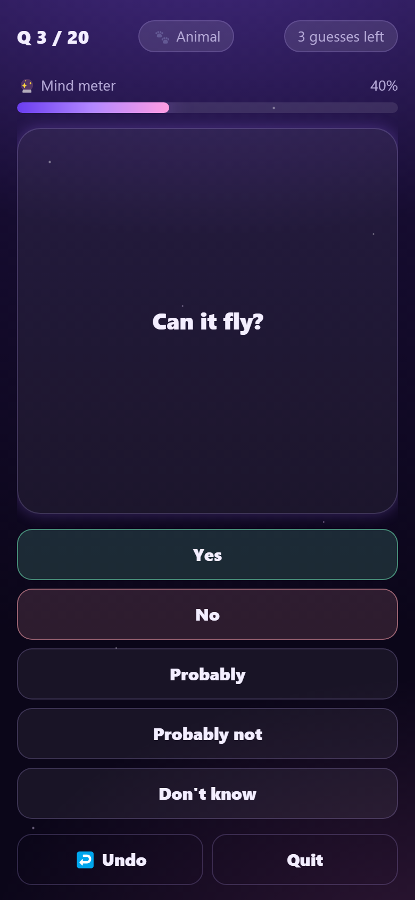
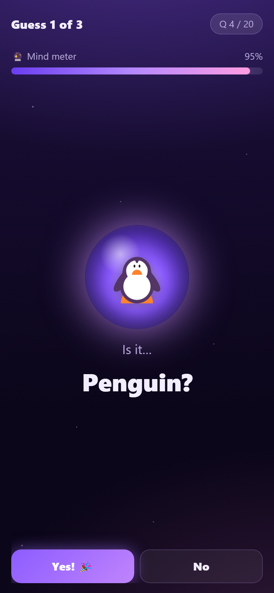
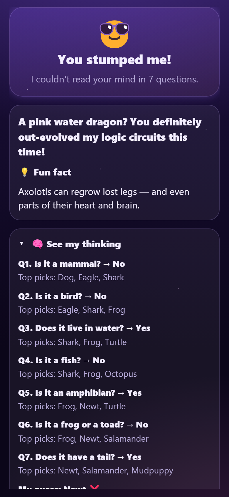
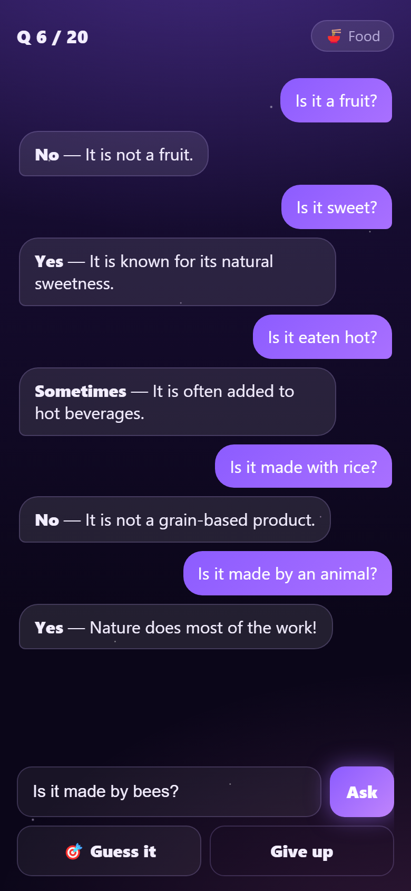
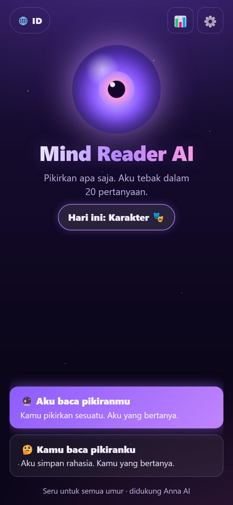

# Mind Reader AI

**Think of anything. I'll guess it in 20 questions.** Think of an animal, a food, a place, a famous person or a character, and Mind Reader AI tries to read your mind with yes/no questions. Or flip it: the AI keeps a secret and you ask the questions. Mind Reader AI is an app on [Anna](https://anna.partners).

Play in English, Bahasa Indonesia or Hinglish. *Pikirkan apa saja — aku tebak dalam 20 pertanyaan!*

- [Privacy policy](privacy/)
- Contact: harshal456951@gmail.com

## Screenshots

  

  
